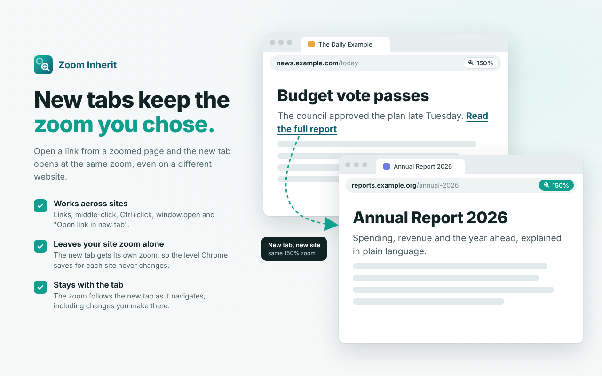

# Zoom Inherit


A Chrome extension that makes a tab opened from another tab start at that tab's zoom level, even when the new tab is on a different website.

Chrome remembers zoom per site. Zoom a page to 150%, open a link to another site, and the new tab opens at 100%. With Zoom Inherit it opens at 150%.



## What it does

- Works for links that open new tabs (`target=_blank`), middle-click, Ctrl/Cmd+click, "Open link in new tab" and `window.open`.
- Gives the new tab its own zoom level (Chrome's per-tab zoom scope), so the zoom Chrome saves for each site never changes.
- Keeps the inherited zoom as the new tab navigates. A manual zoom change in that tab becomes its new level, and tabs opened from it inherit that.
- Leaves tabs you open yourself (Ctrl+T, bookmarks, the address bar) alone.

To have only the first page of a new tab inherit, set `STICKY = false` at the top of `extension/background.js`.

**Conflicts:** turn off other zoom extensions (W Zoom, Zoom for Chrome, Zoom Per Tab and so on). Two extensions controlling zoom will fight.

## Install (unpacked)

1. Open `chrome://extensions` and turn on **Developer mode**.
2. Click **Load unpacked** and choose the `extension/` folder.

## How it works

1. `webNavigation.onCreatedNavigationTarget` reports a tab opened from another tab. As a fallback, `tabs.onCreated` uses `openerTabId` and skips blank new-tab pages. The extension then reads the opener's zoom with `tabs.getZoom`.
2. Chrome resets per-tab zoom settings on every navigation. After each main-frame commit (`webNavigation.onCommitted`), the extension sets the tab to `scope: "per-tab"` and applies the stored zoom.
3. `tabs.onZoomChange` events in per-tab scope update the stored level, so manual zoom changes persist.
4. The tab-to-zoom map lives in `chrome.storage.session`. It survives service-worker restarts and clears when the browser closes.

Permissions: `tabs`, `webNavigation`, `storage`. The extension has no host permissions and makes no network requests.

## Development

```sh
npm install
npm test          # end-to-end test in headless Chromium
npm run render    # regenerate icons and store images from design/
```

`npm test` loads `extension/` into Chromium, serves `test/site/` on three hosts (`127.0.0.1`, `localhost`, `127.0.0.2`) and checks 12 cases. It uses Playwright's bundled Chromium (`npx playwright install chromium`), or set `CHROME_PATH` to Chrome for Testing. Branded Chrome 137+ ignores `--load-extension`, so you can't use it here.

## Publishing

Zip the *contents* of `extension/`, so `manifest.json` sits at the root of the zip:

```sh
cd extension && zip -r ../zoom-inherit.zip .                                         # macOS/Linux
Compress-Archive -Path extension\* -DestinationPath zoom-inherit.zip -Force          # PowerShell
```

Bump `"version"` in `extension/manifest.json` before every upload. Store listing text, permission justifications and privacy answers are in [`store/LISTING.txt`](store/LISTING.txt).

## Layout

```
extension/   the extension (this is what gets zipped)
store/       Chrome Web Store images and listing copy
design/      icon SVGs, screenshot/promo HTML, render script
test/        end-to-end test and its fixture pages
```
